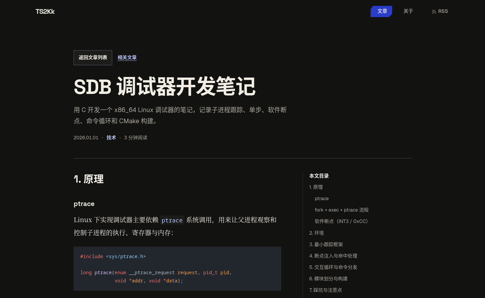

# TS2Kk Blog

TS2Kk 的中文技术博客，记录二进制安全、逆向工程、Linux 和工具开发，也收录参加 CTF 时写下的题解。

[在线阅读](https://mel-srk.github.io/TS2Kk_Blogs/) · [文章归档](https://mel-srk.github.io/TS2Kk_Blogs/posts/) · [关于作者](https://mel-srk.github.io/TS2Kk_Blogs/about/) · [RSS 订阅](https://mel-srk.github.io/TS2Kk_Blogs/rss.xml)

[](https://mel-srk.github.io/TS2Kk_Blogs/)

## 浏览博客

- [神舟2026 epitaph Writeup](https://mel-srk.github.io/TS2Kk_Blogs/posts/ctf-reverse-shen-zhou2026-epitaph/) 记录一道字节码虚拟机逆向题的分析和验证过程。
- [SDB 调试器开发笔记](https://mel-srk.github.io/TS2Kk_Blogs/posts/sdb-debugger/) 从 Linux 进程跟踪讲起，记录如何用 C 写一个调试器。

归档支持按标题、摘要、分类和标签搜索，也可以直接筛选分类。长文可通过目录跳转，文末可以继续查看相关文章。首页的钴蓝色背景在切页时收拢成导航选中块，转场会遵循系统的减少动态效果设置。

| 文章归档 | 正文阅读 |
| --- | --- |
| [](docs/screenshots/archive.webp) | [](docs/screenshots/article.webp) |

<details>
<summary>移动端首页</summary>

<p></p>

</details>

## 本地运行

项目用 Astro 将 Markdown 生成为静态页面。建议使用与部署工作流一致的 **Node.js 24**。

```sh
git clone https://github.com/Mel-SRK/TS2Kk_Blogs.git
cd TS2Kk_Blogs
npm ci
npm run dev
```

默认可在浏览器打开 `http://localhost:4321/`。提交前用 `npm run check` 检查 Astro 和 TypeScript，再用 `npm run build` 生成 `dist/`。运行 `npm run preview` 可以预览构建产物。

## 写文章

在 [`src/content/posts/`](src/content/posts/) 新建 Markdown 文件。文件名会成为网址的一部分，例如 `linux-notes.md` 会生成 `/posts/linux-notes/`。

```markdown
---
title: Linux 调试笔记
description: 记录这次排查的现象、判断和结果。
pubDate: '2026-11-26'
category: 技术
tags: [Linux, 调试]
---

## 问题背景

在这里开始写正文。
```

`title`、`description`、`pubDate` 和 `category` 必填。想更换首页精选时，给新文章加上 `featured: true`，再去掉旧文章的精选标记。分享封面可通过 `cover` 选择，有效值见 [文章字段定义](src/content.config.ts)。站点名、头像路径和作者信息都在 [`src/lib/site.ts`](src/lib/site.ts)。

## 发布到 GitHub Pages

这个仓库在推送到 `main` 后自动发布。[部署工作流](.github/workflows/deploy.yml) 会安装依赖、运行检查、构建 `dist/`，再把生成的静态文件发布到 Pages。也可以在 [Actions](https://github.com/Mel-SRK/TS2Kk_Blogs/actions/workflows/deploy.yml) 手动运行。

在自己的仓库部署时，到 **Settings → Pages → Build and deployment**，将 **Source** 设为 **GitHub Actions**。工作流会把 Pages 提供的站点地址传给 Astro，构建时一并处理项目子路径。 [GitHub Pages 发布源设置](https://docs.github.com/en/pages/getting-started-with-github-pages/configuring-a-publishing-source-for-your-github-pages-site)

需要在本机检查 Pages 的项目子路径时，可以用实际部署地址构建和预览。

```sh
SITE_URL=https://mel-srk.github.io/TS2Kk_Blogs/ npm run build
SITE_URL=https://mel-srk.github.io/TS2Kk_Blogs/ npm run preview
```
